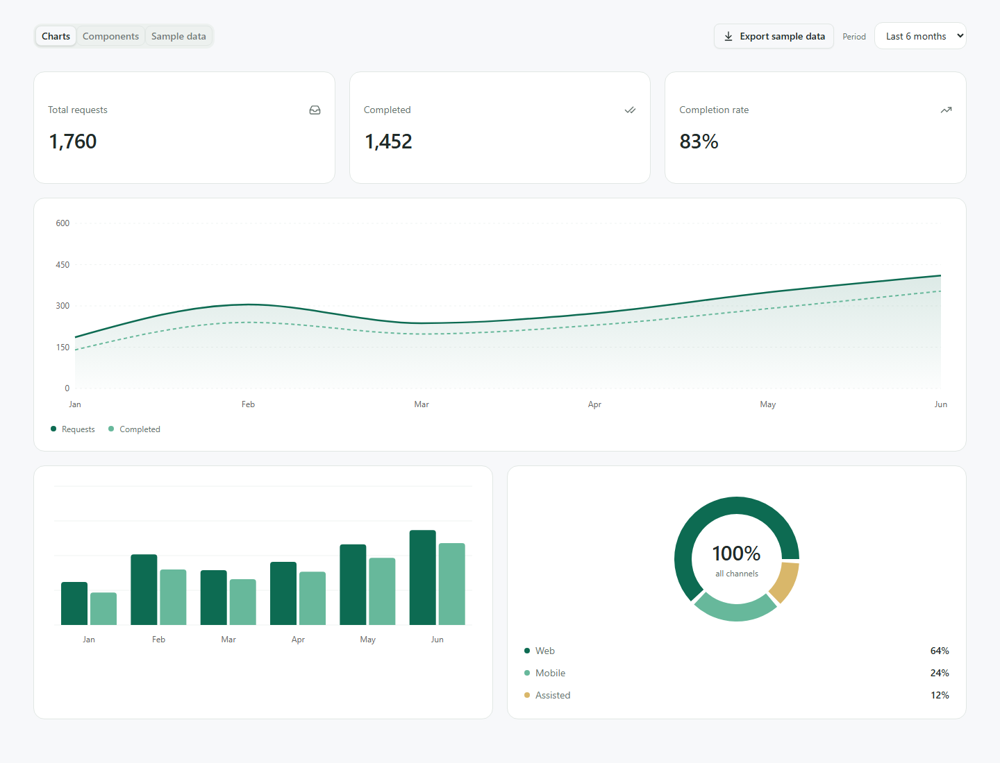
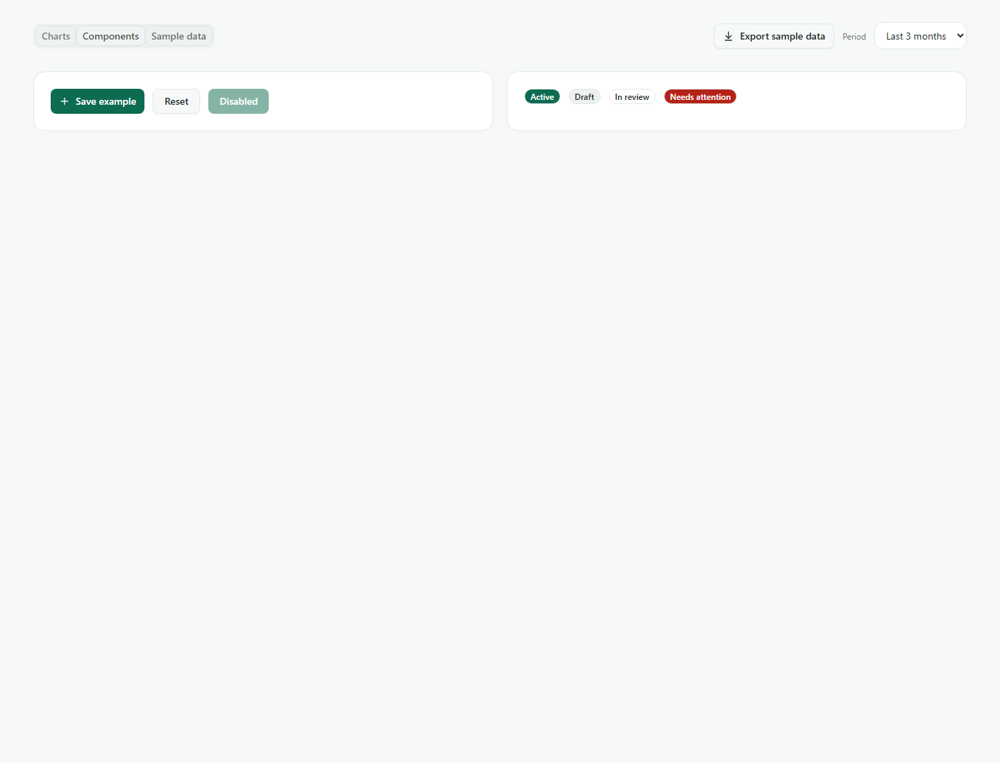

# Stack





## Setup

Install [Git](https://git-scm.com/downloads), [Node.js 22.12+](https://nodejs.org/) and [Python 3.11+](https://www.python.org/downloads/). On Windows, select **Add Python to PATH** and reopen your terminal.

```sh
git clone https://github.com/mitchellrevil/stack.git my-app
cd my-app
npm run setup
npm run dev
```

Open **http://localhost:5173**. API docs: **http://127.0.0.1:8000/docs**.

Setup installs packages, creates `backend/.venv` and copies the example settings to `backend/.env` if it does not exist.

Press **Ctrl+C** to stop. Frontend changes reload automatically. Restart after changing Python code or backend settings.

## Working with AI

Ask your assistant to read [AGENTS.md](AGENTS.md), then describe what you want to build.

## Frontend structure

Each feature keeps its page, components, API calls and hooks together. Shared controls live in `components/ui`. `app` connects routes and providers; `api` handles requests; `auth` handles sign-in and permissions.

## Packages

| Package                                                                                                           | Purpose                                                     |
| ----------------------------------------------------------------------------------------------------------------- | ----------------------------------------------------------- |
| React and TypeScript                                                                                              | Components and checked types.                               |
| Vite                                                                                                              | Development server and production builds.                   |
| TanStack Router                                                                                                   | Typed routes.                                               |
| TanStack Query                                                                                                    | API loading, errors and caching.                            |
| shadcn/ui, Radix and Base UI                                                                                      | Editable UI components with built-in interaction behaviour. |
| Tailwind, `cn`, class-variance-authority and tw-animate-css                                                       | Styling, class merging, variants and animations.            |
| Recharts and Lucide                                                                                               | Charts and icons.                                           |
| Zod                                                                                                               | API response validation.                                    |
| MSAL                                                                                                              | Entra sign-in and token renewal.                            |
| React Hook Form and resolvers                                                                                     | Forms and schema validation.                                |
| Day Picker, date-fns, Embla, cmdk, Vaul, input-otp, react-resizable-panels, Sonner, next-themes and @shadcn/react | Dependencies of the included shadcn components.             |
| ESLint, Prettier and TypeScript                                                                                   | Linting, formatting and type checks.                        |

The chart samples use made-up data. No database is needed.

## Sign-in

Edit `backend/.env` and restart. Leave `ENTRA_CLIENT_ID` blank to run without authentication.

```dotenv
ENTRA_CLIENT_ID=your-application-client-id
ENTRA_TENANT_ID=your-tenant-id
ENTRA_API_CLIENT_ID=
ENTRA_SCOPE=access_as_user
```

Follow [the Entra setup steps](docs/authentication.md). The frontend reads its settings from the API. No app role is required. Permission helpers are included for features that need them.

With a client ID set, the API requires a valid access token. Invalid settings or failed sign-in do not disable authentication.

## Folder structure

```text
frontend/src/
  api/                  # Shared HTTP client and common response contracts
  app/                  # App shell, router and providers
  auth/                 # Entra config, token handling and permission helpers
  components/ui/        # Full shadcn component source
  features/
    auth/components/    # Sign-in page and permission guard
    chart-demo/
      api/              # Chart response contract and API call
      components/       # The individual charts and examples
      hooks/            # Query hook
      ChartDemoPage.tsx
  hooks/                # Shared shadcn mobile hook
  lib/                  # Small shared UI helper
backend/
  app/
    api/v1/router.py    # Versioned route registration
    routes/             # Auth, health and chart endpoints
    models/             # API response models
    auth.py             # Token validation and permission dependency
    config.py           # Environment settings
    dependencies.py     # Shared FastAPI dependencies
    main.py             # App creation
scripts/project.mjs     # Setup, start and check commands
AGENTS.md               # Guidance for working with an AI assistant
```

See [the architecture notes](docs/architecture.md) for adding a feature, API route or database.

## Checks

```sh
npm run check
npm run format:check
```

Runs frontend linting, type checking and a production build, plus Python linting and formatting checks. Tests are not included.

Use `npm run format` to format application files. Imported shadcn components keep their upstream formatting.
